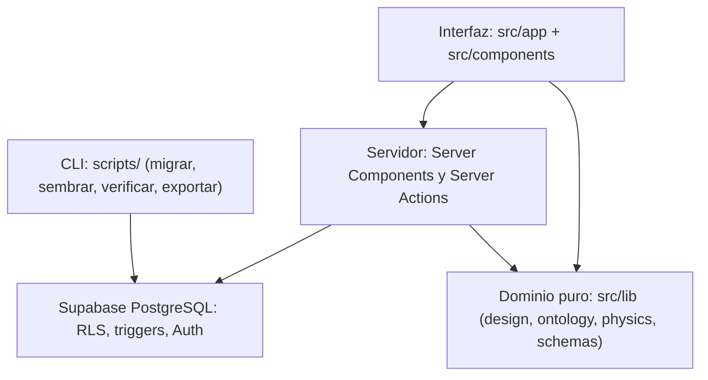
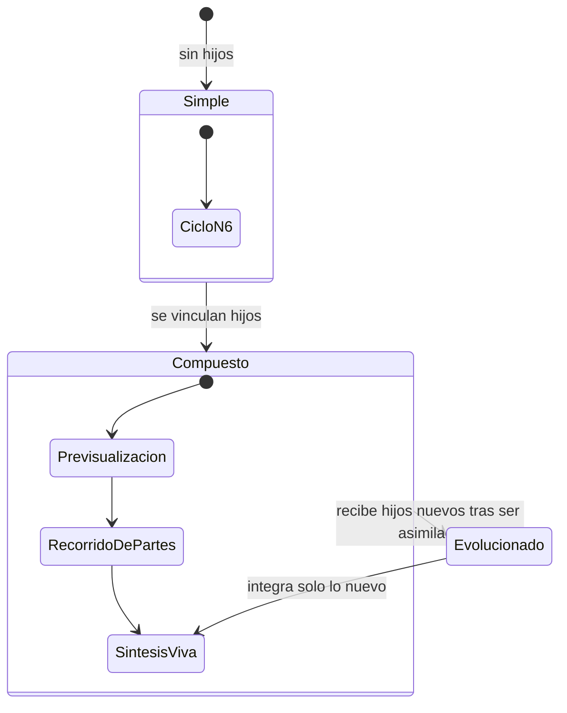
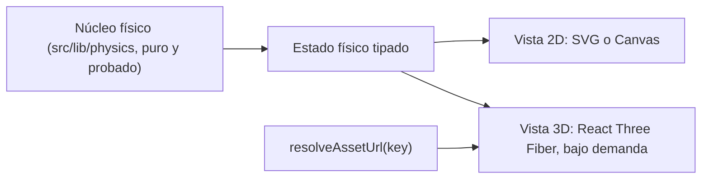

# Arquitectura

> Describe el **diseño objetivo**. Lo marcado como *objetivo* se implementa en el Bloque 1.3B-1 y su SQL definitivo se aprueba en esa compuerta. Decisiones relacionadas: ADR-001, 002, 011–016.

## 1. Capas del sistema (monolito modular)

| Frontera | Ubicación | Garantía |
| :--- | :--- | :--- |
| Datos y reglas de acceso | `supabase/migrations/` | RLS, anti-ciclos e inmutabilidad en el motor SQL |
| Servidor | Server Components, `actions.ts`, `src/proxy.ts` | `server-only`; sesión por cookies HTTP |
| Administración | `scripts/` + `src/lib/supabase/admin.ts` | La secret key nunca se expone por HTTP |
| Dominio puro | `src/lib/**` | Sin React, probado en `tests/**` |

## 2. Estado actual del esquema (migración 0001)
`layers` (L0–L11) · `concept_atoms` · `atom_prerequisites` (DAG con trigger) · `glossary_terms` · `user_atom_progress` · `user_workspace_preferences` · `schema_migrations`. RLS en las 7 tablas.

## 3. Modelo holónico (objetivo)
Una sola entidad universal: el **nodo conceptual**. Su comportamiento depende de su composición, no de un tipo declarado.

- **Simple:** el nodo se aprende con su propio ciclo N-6.
- **Compuesto:** muestra una Previsualización serena del conjunto, un recorrido por sus partes en orden de descubrimiento y una Síntesis Viva que explica cómo trabajan juntas. **Transición sin pérdida:** cuando un nodo que nació Simple (con su ciclo N-6, progreso y notas del autor) recibe hijos más adelante, no se destruye ni queda huérfano su contenido ni su historial; todo queda preservado e integrado en su Síntesis Viva.
- **Evolucionado:** era un nodo asimilado y recibió hijos nuevos. Conserva progreso y notas, marca lo nuevo y su síntesis lo integra.
- **Conexión Capa ↔ Holón:** cada estrato `L0–L11` mantiene `layers` como índice ontológico y enlaza su propio **nodo raíz** en `concept_nodes` (`root_node_id`), de modo que abrir una capa desde `/` conduce directamente a su Previsualización viva sin casos especiales.

### Entidades objetivo
| Entidad | Propósito | Campos clave |
| :--- | :--- | :--- |
| `concept_nodes` | Nodo universal (evoluciona desde `concept_atoms`) | `id` y `slug` (`^[a-z0-9-]+$`, sin puntos) inmutables, `code`, `title`, `home_layer`, `status`, `forbidden_terms`, `content_json`, `schema_version`, `content_revision`, `primary_quantity`, `simulator_key` |
| `node_compositions` | Padre ↔ hijo, M:N | `parent_id`, `child_id`, `role_in_parent`, `integration_note`, `group_label` (opcional, para agrupar 10–20+ hijos sin abrumar), `structural_order`, `discovery_order`; trigger anti-ciclos |
| `node_relations` | Grafo semántico tipado | `from_id`, `to_id`, `kind` ∈ {`prerequisite`, `contrast`, `recall_bridge`}, `strength`, `context_note` (opcional, explica el eje de contraste o el motivo del puente); anti-ciclos solo para `prerequisite` |
| `node_revisions` | Historial por nodo completo publicado | `node_id`, `revision`, `content_json`, `published_at` |
| `user_node_progress` | Progreso por usuario y nodo | estado holónico, etapa y `scene_id` actuales, `assimilated_revision`, `evolved_since` |
| `user_node_notes` | Notas propias versionadas | `node_id`, `note_kind` ∈ {`mental_image`, `living_synthesis`}, `stage_number` (opcional: `4` para Etapa 4, `NULL` en Síntesis Viva), `scene_id` (identificador estable inmutable, nunca índice numérico posicional), `body`, `node_revision`; nunca se sobrescriben |

> Composición y prerrequisito son relaciones distintas: "forma parte de" no equivale a "debe aprenderse antes". Por eso viven en tablas separadas con reglas de ciclo propias.

## 4. Brújula de Profundidad (objetivo)
Un mismo hijo puede tener varios padres, así que "volver" depende de por dónde se entró.
- **Ruta canónica única:** `/nodo/[slug]?via=padre-a.padre-b` (se retira `/atomo/[slug]`).
- **Higiene de `slug` y `?via=`:** todo `slug` cumple estrictamente `^[a-z0-9-]+$` (sin guiones iniciales/finales y sin puntos `.`, haciendo inequívoco el separador `.` de `via`). Al leer o construir `via` se aplica **sanitización silenciosa + colapso/deduplicación de bucles** (se descartan slugs inválidos o el propio `slug` destino, y si aparece un ciclo `a.b.c.b` se colapsa a `a.b` con cota máxima de profundidad) para que la URL nunca crezca indefinidamente.
- La miga de pan se reconstruye desde `via`. El botón de retorno lleva al padre inmediato y la cabecera muestra el `role_in_parent` del hijo **en ese contexto**.
- Si se entra sin `via` (enlace directo), se ofrecen los padres conocidos sin imponer ninguno.

## 5. Recuerdo Contextual X ↔ YZ (objetivo)
El marcador `{{recall:slug}}` dentro de una escena de X abre un popover con la nota propia del aprendiz en YZ (o, si aún no la escribió, el nombre de YZ y la invitación a visitarlo), sin salir de la escena.

## 6. Laboratorio multimedia

Carga diferida por `simulator_key` · un solo contexto WebGL · `dispose` al desmontar · pausa con la pestaña oculta · activos desacoplados para R2 (ADR-015).

## 7. Integridad y portabilidad
- Inmutabilidad de `id` y `slug` por trigger. `content_revision` crece con cada publicación.
- Tests que validan todos los marcadores `{{term:}}`, `{{recall:}}` y `{{sim:}}` contra entidades existentes.
- `pnpm export` (objetivo): volcado completo de nodos, relaciones, progreso y notas a `exports/` en JSON y Markdown legible.
