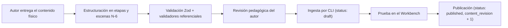

# Guía de autoría

> Cómo pasa un concepto de la mente del autor a la plataforma sin perder rigor. Decisiones: ADR-006, ADR-014 y ADR-016. El contrato Zod definitivo se crea en el Bloque 1.3B-1.

## Principio
Solo se publica lo que el autor ya asimiló y validó. El asistente puede estructurar, proponer escenas y revisar la coherencia causal, pero **no inventa física, datos técnicos ni ejemplos sin fuente**.

## Flujo de un nodo

## Lista de comprobación antes de publicar
- [ ] Prerrequisitos declarados y ya publicados (o justificados).
- [ ] Etapas 1–4 sin la etiqueta técnica oficial del propio nodo: validado en `pnpm test` contra la lista explícita `forbidden_terms` del nodo con coincidencia de palabra o frase completa (evitando falsos positivos en español como `"par"` dentro de `"para"`).
- [ ] Una idea causal dominante por escena, cada una con `scene_id` estable inmutable.
- [ ] Compuerta de la Etapa 3 (predicción) y de la Etapa 4 (nota propia) definidas.
- [ ] Todos los `{{term:}}`, `{{recall:}}` y `{{sim:}}` resuelven a entidades existentes (verificado automáticamente en `pnpm test`).
- [ ] Etapa 6 con su contraste (si es un nodo de diseño).
- [ ] Fuentes citadas para cada dato numérico o normativo.
- [ ] Si es compuesto: `role_in_parent`, aporte de integración, `group_label` opcional (cuando hay muchas partes), orden estructural y orden de descubrimiento de cada hijo, y escena de Síntesis Viva.

## Marcadores
| Marcador | Significado |
| :--- | :--- |
| `{{term:slug}}` | Término del Glosario Vivo (popover con imagen mental + formalización) |
| `{{recall:slug}}` | Puente de recuerdo hacia un nodo previo (ficha con la nota propia del aprendiz) |
| `{{sim:key}}` | Escena de laboratorio que activa el simulador registrado |

## Identidad y cambios
- `slug`: estrictamente `^[a-z0-9-]+$` (kebab-case sin puntos `.`, inmutable, nunca se reutiliza). Ruta canónica universal: `/nodo/[slug]`.
- `code`: posición ontológica legible (por ejemplo `L0.1`), pero no es la identidad primaria.
- Editar contenido publicado incrementa `content_revision` por nodo completo en `node_revisions`. Las notas del aprendiz quedan ancladas a `node_revision` + `note_kind` + `scene_id` estable; si un nodo simple pasa después a compuesto, su contenido N-6 y sus notas quedan preservados e integrados en su Síntesis Viva.

## Primer nodo
`L0.1` se calibra en el Hito 1.4 con contenido que entrega el autor. Hasta entonces, la interfaz muestra "Contenido en preparación".
