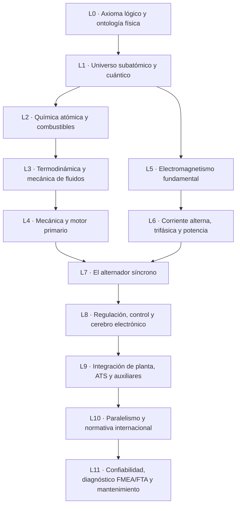

# Ontología del dominio — Grupos Electrógenos (L0 → L11)

> **Importante (ADR-006):** Este documento define únicamente el **mapa estructural de estratos y ejes de contraste** para orientar la arquitectura. **No es contenido pedagógico publicado.** Cada nodo real se construye y publica solo cuando el autor entrega y valida su contenido asimilado.

## 1. Topología causal de estratos

El dominio se organiza en doce estratos causales (`L0`–`L11`). El aprendizaje parte del axioma lógico y la materia subatómica, se abre en dos ramas físicas paralelas (conversión termo-mecánica y conversión electromagnética) y converge en el alternador síncrono hasta llegar a la operación normativa y el diagnóstico de campo.

- **Rama de la energía (`L2 → L3 → L4`):** *la energía se vuelve giro* (enlace químico → calor y presión → par mecánico en el eje).
- **Rama del campo (`L5 → L6`):** *el campo se vuelve tensión* (carga, flujo e inducción → ondas alternas, trifásica y potencia).
- **Convergencia (`L7`):** el eje mecánico y el campo magnético se acoplan en la máquina síncrona.

## 2. Alcance físico de cada estrato

| Estrato | Nombre | Alcance causal | Magnitud física predominante |
| :---: | :--- | :--- | :--- |
| `L0` | Axioma lógico y ontología física | Causalidad, sistema/entorno, conservación y transformación de energía | Monocromo (estructural) |
| `L1` | Universo subatómico y cuántico | Quarks, gluones, nucleones, electrones, espín y bandas de conducción/aislamiento/semiconducción | Monocromo / `electric` |
| `L2` | Química atómica y combustibles | Enlaces covalentes, hidrocarburos (diésel, gas), oxidación, lubricantes, refrigerantes y electroquímica de baterías | `thermal` |
| `L3` | Termodinámica y mecánica de fluidos | Temperatura, presión, compresión adiabática, ciclos Diésel/Otto, transferencia de calor y flujo | `thermal` |
| `L4` | Mecánica y motor primario | Fuerza, par, potencia en el eje, inercia, cinemática y subsistemas del motor de combustión | `mechanical` |
| `L5` | Electromagnetismo fundamental | Potencial, corriente, dominios ferromagnéticos, histéresis, inducción de Faraday-Lenz y fuerza de Lorentz | `magnetic` |
| `L6` | Corriente alterna, trifásica y potencia | Frecuencia, valor eficaz (RMS), impedancia, fasores, estrella/delta, triángulo de potencias y armónicos | `electric` |
| `L7` | El alternador síncrono | Estator, rotor, paso de bobinado, con/sin escobillas, puente rectificador rotativo y sistemas de excitación | `magnetic` / `electric` |
| `L8` | Regulación, control y cerebro electrónico | Gobernador, AVR, sensores (MPU, presión, temperatura), protecciones y controladores maestros | `signal` |
| `L9` | Integración de planta, ATS y auxiliares | Bancada, acústica, ventilación, sistema de combustible, precalentamiento, conmutación ATS y puesta a tierra | Monocromo (sistema) |
| `L10` | Paralelismo y normativa internacional | Sincronización, reparto activo/reactivo, ISO 8528, NFPA 110 y derating ambiental | Monocromo (sistema) |
| `L11` | Confiabilidad, diagnóstico FMEA/FTA y mantenimiento | Modos de falla, árboles de diagnóstico trazables a física fundamental, pruebas eléctricas/fluidos, bancos de carga y LOTO | Monocromo (operación) |

## 3. Relación entre estratos y nodos holónicos

Un estrato `L0–L11` indica **dónde vive primariamente** un concepto (`home_layer`), pero no limita su profundidad interna:
- Un componente situado en `L4` (por ejemplo, una bomba de cebado manual o un inyector) puede empezar como nodo simple y después abrirse en sus propias sub-partes internas mediante `node_compositions`.
- Una pieza elemental (por ejemplo, una válvula antirretorno o un diodo rectificador) se define **una sola vez** y puede participar como hijo en varios sistemas padres declarando su `role_in_parent` específico en cada uno.

## 4. Ejes canónicos de contraste dialéctico (Etapa 6 · "Compáralo")

Cada estrato —**desde las capas fundacionales hasta la ingeniería de planta**— tiene sus propios espejos conceptuales (por ejemplo, en `L1`: conductor ↔ aislante ↔ semiconductor; en `L2`/`L3`: combustión completa ↔ incompleta, transformación reversible ↔ irreversible; en `L5`/`L6`: imán permanente ↔ electroimán, corriente continua `DC` ↔ corriente alterna `AC`).

La siguiente tabla recoge una **muestra ilustrativa** de ejes de contraste de ingeniería del grupo electrógeno que se abordarán cuando el avance llegue a sus estratos respectivos:

| Dimensión de ingeniería | Eje de contraste en espejo |
| :--- | :--- |
| Transferencia de excitación al rotor | Con escobillas y anillos rozantes ↔ Sin escobillas (*brushless*) |
| Alimentación del regulador de tensión | Excitación Shunt ↔ PMG (imán permanente) ↔ AREP (devanados auxiliares) |
| Ciclo termodinámico del motor primario | Encendido por compresión (Diésel) ↔ Encendido por chispa (Otto: gas natural / GLP / biogás) |
| Aspiración de aire | Aspiración natural ↔ Turboalimentado ↔ Turboalimentado y posenfriado |
| Regulación de velocidad y frecuencia | Modo isócrono ↔ Modo *droop* (estatismo) |
| Conexión de devanados trifásicos | Estrella ($Y$) ↔ Delta ($\Delta$) y reconexión de 12 terminales |
| Conmutación de transferencia (ATS) | Transición abierta ↔ Transición cerrada ↔ Transición retardada ↔ *Bypass* de aislamiento |
| Régimen nominal (ISO 8528-1) | Emergencia (*ESP*) ↔ Potencia primaria (*PRP*) ↔ Tiempo limitado (*LTP*) ↔ Continua (*COP*) |
| Evacuación térmica | Refrigeración por aire ↔ Refrigeración líquida (radiador en bancada ↔ radiador remoto / intercambiador) |
| Ensayo bajo carga | Banco puramente resistivo ($\cos\varphi = 1$) ↔ Banco resistivo-reactivo ($\cos\varphi = 0{,}8$) |
| Puesta a tierra del neutro | Neutro sólidamente puesto a tierra ↔ Puesto a tierra por impedancia ↔ Neutro aislado |
